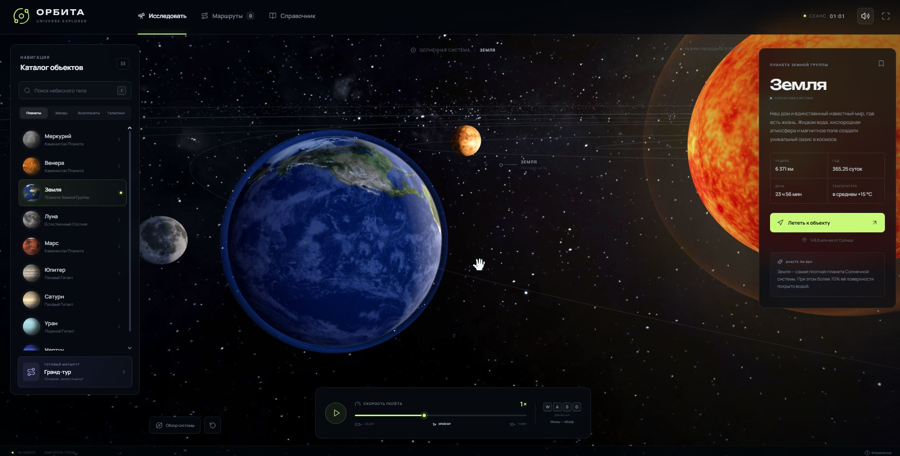

# Орбита — путешествие по вселенной

Интерактивный 3D-симулятор исследования космоса в браузере: Солнечная система с реальными орбитальными периодами, звёзды, экзопланеты и галактики, собранные из десятков тысяч частиц.

  



## Возможности

- **31 объект** в четырёх категориях: планеты и Луна, звёзды (Сириус, Бетельгейзе, TRAPPIST-1 и др.), экзопланеты (Проксима b, Kepler-452 b…), галактики (Млечный Путь, Андромеда, Сомбреро, Сигара…)
- **Два масштабных уровня** — звёздный и галактический с автоматическим переключением: влетите в Млечный Путь, чтобы оказаться среди звёзд; улетите достаточно далеко — и вокруг останутся только галактики
- **Реальные соотношения орбит**: земной год ≈ 120 секунд при скорости 1×, наклоны осей и орбит — по справочным данным
- **Галактики из частиц**: до 68 000 звёзд на объект с балджем, баром и спиральными рукавами
- **Процедурные текстуры**: поверхности экзопланет и звёзд генерируются на canvas на лету
- **Гранд-тур** — готовый маршрут из 10 миров: Солнечная система → Сириус → Проксима b → Андромеда → возврат к Солнцу
- **Маршруты** — сохранение объектов в журнал (localStorage)
- **Свободный полёт** — WASD/QE + мышь, автопилот, регулируемая скорость 0.1×–100×
- **Динамический звук** — закольцованный трек, громкость растёт при приближении к любому объекту (150%) и затухает вдали (30%)

## Запуск

```bash
npm install
npm run dev      # http://localhost:5173
npm run build    # продакшн-сборка в dist/
npm run preview  # предпросмотр сборки
```

## Управление

| Действие | Управление |
|---|---|
| Осмотреться | ЛКМ + движение мыши |
| Приближение | Колесо мыши |
| Полёт | `W` `A` `S` `D`, `Q`/`E` — вниз/вверх, `Shift` — ускорение |
| Автопилот | `Space` или кнопка воспроизведения |
| Поиск | `/` |
| Курс на объект | Клик по планете/звезде/галактике или кнопка «Лететь к объекту» |

## Структура

```
├── index.html          # входная точка
├── public/textures/    # текстуры NASA / JPL, Solar System Scope + noise.mp3
└── src/
    ├── main.js         # UI: каталог, детали, маршруты, тур, звук
    ├── scene.js        # UniverseScene: Three.js-сцена, уровни масштаба, перелёты
    ├── data.js         # каталог объектов + маршрут Гранд-тура
    └── style.css       # стили интерфейса
```

## Технологии

- [Three.js](https://threejs.org) — рендеринг сцены (WebGL, кастомные шейдеры для частиц и атмосфер)
- [Vite](https://vite.dev) — сборка и dev-сервер
- [Lucide](https://lucide.dev) — иконки
- Web Audio API — фоновый звук с динамической громкостью по близости объектов

## Примечание о масштабе

Орбитальные расстояния и соотношения периодов в Солнечной системе соответствуют реальным, но время ускорено. Размеры тел увеличены для наглядности. Звёзды и поверхности экзопланет — художественная процедурная реконструкция. Текстуры планет: NASA / JPL, Solar System Scope.
